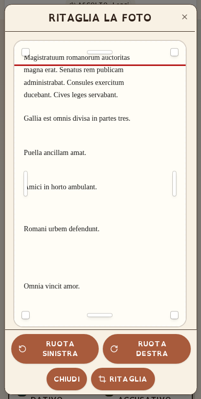

# Latino Facile

App didattica per analizzare e colorare le frasi latine, leggere il testo da una foto, scrivere una traduzione e scaricare il PDF. Interfaccia e PDF usano font OpenDyslexic auto-ospitati.

> **Pacchetto sorgente completo, non una build già compilata.** Estrarre lo ZIP, entrare nella cartella `latino-facile-app/` e usare le guide sotto. Su GitHub devono essere nella **radice della repository** `package.json`, `pnpm-lock.yaml` e `render.yaml`: non caricare il solo ZIP né una cartella annidata in più.
>
> **Versione pubblicata: produzione 9010 del 07/11/2026**, codice `de7b501e1de807fa1084be3957a2b17b40ea3394`. La seconda pagina è più compatta su mobile e la sincronizzazione della cornice è aggiornata; IA, legenda, palette e ritaglio sono preservati. Provenienza, verifiche e limiti: [RILASCIO-9010.md](RILASCIO-9010.md). Le produzioni [9001](RILASCIO-9001.md), [8990](RILASCIO-8990.md), [8985](RILASCIO-8985.md), [8980](RILASCIO-8980.md) e [8802](RILASCIO-8802.md) sono storiche.
>
> **Pacchetto aggiornato dopo il deploy:** le guide e le risorse del blog sono successive alla pubblicazione; il codice applicativo rimane quello del checkpoint 9010. È inclusa la cornice LATINO confrontata con il post pubblico e, separatamente, la documentazione delle altre cornici. L'esportazione non pubblica nuove versioni.
>
> **Accessibilità da preservare:** [ACCESSIBILITA.md](ACCESSIBILITA.md). Le misure presenti non costituiscono una certificazione WCAG/PDF-UA o una validazione clinica/didattica per tutti gli studenti.

## Scegli il percorso

| Obiettivo | Documento |
|---|---|
| Avvio rapido e mappa del pacchetto | Questo README e [docs/STRUTTURA.md](docs/STRUTTURA.md) |
| Ricostruire **questa app identica** | [REBUILD.md](REBUILD.md) |
| Creare una copia e **adattarla** a un'altra lingua o attività | [ADATTARE.md](ADATTARE.md) |
| Trasferire da ZIP a **GitHub → Render** | [RENDER.md](RENDER.md) |
| Lavorare con un agente IA senza altre chat o skill | [AGENTS.md](AGENTS.md) |
| Configurare chiavi, servizi esterni e database opzionale | [docs/CONFIGURAZIONE.md](docs/CONFIGURAZIONE.md), [.env.example](.env.example) |
| Foto, riconoscimento e ritaglio | [OCR-FOTO.md](OCR-FOTO.md), [SCROLLING-MOBILE.md](SCROLLING-MOBILE.md) |
| Trapiantare **solo** il cropper | [PHOTO-CROP-CLONABILE.md](PHOTO-CROP-CLONABILE.md), 18 sorgenti incorporati |
| Inserire l'app nel blog | [cornice-dinamica/README.md](cornice-dinamica/README.md) |
| Cornice LATINO pubblicata, 15 codici Word e verifiche dei post | [docs/blog/README.md](docs/blog/README.md) |
| Verificare o rigenerare lo ZIP | [docs/ESPORTAZIONE.md](docs/ESPORTAZIONE.md) |
| Conoscere il riordino e i limiti dei controlli | [docs/portabilita/RIORDINO.md](docs/portabilita/RIORDINO.md) |
| Identificare il codice della versione pubblicata 9010 | [RILASCIO-9010.md](RILASCIO-9010.md) |
| Consultare i controlli dell'anteprima mobile, prima del deploy 9010 | [Rapporto storico](docs/portabilita/RAPPORTO-ANTEPRIMA-MOBILE-2026-11-07.md) |
| Consultare il rilascio precedente 9001 | [RILASCIO-9001.md](RILASCIO-9001.md) |
| Consultare il rilascio precedente 8990 | [RILASCIO-8990.md](RILASCIO-8990.md) |
| Consultare il rilascio precedente 8985 | [RILASCIO-8985.md](RILASCIO-8985.md) |
| Consultare la ricostruzione dello ZIP 8985 | [docs/portabilita/VERIFICHE-8985-2026-11-06.md](docs/portabilita/VERIFICHE-8985-2026-11-06.md) |
| Consultare il rilascio precedente 8980 | [RILASCIO-8980.md](RILASCIO-8980.md) |
| Consultare il rilascio e lo ZIP precedente 8802 | [RILASCIO-8802.md](RILASCIO-8802.md) e [collaudo della copia estratta 8802](docs/portabilita/VERIFICHE-8802-2026-10-31.md), entrambi storici |
| Consultare il precedente riordino, solo storico | [docs/portabilita/VERIFICHE-2026-10-29.md](docs/portabilita/VERIFICHE-2026-10-29.md) |

## Requisiti e avvio locale

- Node **22.22.2**, indicato anche in [.node-version](.node-version); il minimo del ramo 22 è **22.13.0**, richiesto da `pdfjs-dist`.
- pnpm **10.4.1**, fissato nel campo `packageManager` con hash; Git per clonare/esportare.
- Python **3.10+** soltanto per il controllo avanzato/esportazione ZIP; non serve al server Render.

```bash
corepack enable
corepack pnpm install --frozen-lockfile --prod=false
cp .env.example .env
# Facoltativo: compilare EASY_PEASY_API_KEY nel solo .env locale.
corepack pnpm dev
```

Aprire `http://localhost:3000`. `/` contiene la scheda studente, `/app` l'attività. Non servono un database, un account o una chiave IA per aprire l'app, usare il motore latino di base e generare PDF.

**Per riprodurre anche le funzioni IA occorre una propria `EASY_PEASY_API_KEY` valida**, configurata sul server: traduzione, verifica dei ruoli e trascrizione foto. La chiave non è inclusa nel pacchetto e non richiede un database. Senza chiave si usano le regole e i ripieghi disponibili; la qualità non è equivalente al percorso IA. Ulteriori dipendenze di rete sono descritte in [CONFIGURAZIONE](docs/CONFIGURAZIONE.md).

## Controlli ripetibili

```bash
corepack pnpm package:check  # struttura, guide, risorse, configurazione e cropper
python3 docs/blog/verifica-evidenze.py  # Word, cornici e riscontri del blog
corepack pnpm test:package   # sicurezza del clone e strumenti di packaging
corepack pnpm check          # TypeScript
corepack pnpm test:ci        # test unitari, esecuzione non parallela
corepack pnpm build          # dist/index.js + dist/public/
corepack pnpm smoke          # avvio produzione isolato, health/API/font/OCR
```

`smoke` avvia e chiude un **proprio** server su una porta libera, senza leggere il `.env` dell'app o usare chiavi/database reali. Controlla anche il contenuto effettivo dei file statici: il semplice HTTP 200 può essere il fallback HTML della SPA e non è sufficiente.

La CI in [.github/workflows/ci.yml](.github/workflows/ci.yml) esegue gli stessi controlli su push/PR `main` e `master`. Non accetta silenziosamente una suite senza test. Non effettua migrazioni, seed o chiamate IA.

## Produzione e Render

```bash
corepack pnpm build
NODE_ENV=production PORT=3000 node dist/index.js
```

Il frontend e le API sono serviti da **un unico processo Express**. Il Blueprint [render.yaml](render.yaml) usa il runtime **Node**, installa anche gli strumenti di build e avvia `node dist/index.js`; `PORT` è assegnata da Render e il server ascolta su `0.0.0.0`. Health check: `GET /_health` → testo `OK`.

Il percorso consigliato è **estrarre → caricare i file su GitHub → New / Blueprint su Render**. Il deploy automatico è configurato con `autoDeployTrigger: checksPass`: Render aspetta i controlli CI della versione collegata. La pubblicazione reale richiede l'account dell'utente, le variabili scelte e una sua operazione esplicita: questo pacchetto non pubblica nulla da solo.

Il [Dockerfile](Dockerfile) alternativo è multistadio e ricostruisce dai sorgenti: non richiede `dist/` nello ZIP. [.dockerignore](.dockerignore) esclude credenziali e file locali. I dettagli e i limiti della verifica Docker sono in [RENDER.md](RENDER.md).

## Clonazione e adattamento

```bash
# Dalla repository sorgente pulita e già committata:
node scripts/clone-app.mjs --target ../nuova-app --name nuova-app --title "NUOVA APP"
```

Il comando copia solo file committati, rifiuta una destinazione esistente e **non** trasferisce `.env`, dipendenze, database o storia Git. Rinomina l'identità, separa i metadati della sorgente e rende esplicito che la nuova app è **una bozza ancora basata sul motore latino**. Non trasforma automaticamente Whitaker e le regole latine in un analizzatore di inglese/francese/spagnolo. Seguire [ADATTARE.md](ADATTARE.md), completare i test della nuova lingua e configurare una propria destinazione di deploy.

## Stato dell'app e risorse preservate

- Base pubblicata: produzione **9010**, codice `de7b501e1de807fa1084be3957a2b17b40ea3394`. Guide e risorse blog sono state aggiornate dopo il deploy; il precedente ZIP denominato anteprima conserva gli stessi sorgenti applicativi pubblicati, ma documenta lo stato prima del deploy.
- Cornice LATINO: [blocco pubblicato verificato](cornice-dinamica/embed-latino-facile-blog-pubblicata-2026-11-07.html). Il [documento Word e le verifiche delle altre cornici](docs/blog/README.md) sono riferimenti del blog, non componenti attivi dell'app; il backup dei post è consegnato separatamente.
- Legenda app: visibile dopo il risultato colorato, non all'apertura o durante l'analisi; griglia **1/2/3 colonne**, etichette senza a-capo (`whitespace-nowrap`), font adattato alla larghezza reale tramite container query. Nel PDF a due colonne `fitOneLine` misura i testi col font incorporato; la spaziatura verticale più ampia della legenda è inclusa nel calcolo della paginazione. I paragrafi di nota sotto la griglia restano testo corrente, non voci della legenda.
- Palette corrente: avverbi `#0057D9`, preposizioni `#BDBDBD`, congiunzioni `#4A4A4A`; altri modi `#795548`. UI, legenda e PDF derivano dalle stesse costanti. Dettagli: [COLORI-PAROLE-SERVIZIO.md](COLORI-PAROLE-SERVIZIO.md).
- Limite corrente: **50 parole**, definito in `Home.tsx`; il limite API di 2000 caratteri è un controllo distinto.
- Cropper: logica della baseline indipendente **8731**, invariata; `modal={true}`, scroll interno, drag diretto, quattro comandi centrati. Dalla 9001 icone e pulsanti si adattano al testo ingrandito; la 9010 aggiorna la sincronizzazione dell'altezza esterna. `confirm()` e `cropBox.ts` non sono stati modificati.
- I nove `quaderno-unico-v*.pdf` sono **asset storici preservati** in `client/public/`, non il PDF dinamico delle frasi. Non reintrodurre pulsanti al quaderno.
- Le vecchie guide contraddittorie sono conservate come testo in [docs/storico](docs/storico/README.md); non sono istruzioni operative.
- Le skill sono un supporto opzionale: [SKILLS-APP.md](SKILLS-APP.md). Tutte le guide necessarie sono già nel repository.

<details>
<summary>Riferimento visivo del ritaglio mobile incluso nel pacchetto</summary>



Il riferimento non sostituisce i sorgenti o il collaudo corrente.
</details>

## Stack e licenze

React 19, Vite 7, TypeScript, Tailwind 4; Express, tRPC, Drizzle/PostgreSQL opzionale; Whitaker, Tesseract.js, pdf-lib. `pnpm-lock.yaml` e la patch di Wouter sono indispensabili per ricostruire le stesse dipendenze.

Il metadato del progetto dichiara MIT; le dipendenze, i font e i dati linguistici mantengono le rispettive licenze. Vedere [docs/LICENZE-E-RISORSE.md](docs/LICENZE-E-RISORSE.md); non attribuire automaticamente la licenza del codice ai PDF o agli altri asset.
