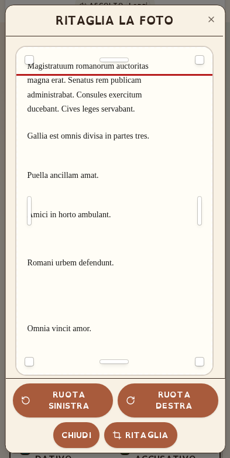

# Verifiche del pacchetto portabile — 29 ottobre 2026

## Esito e versione collaudata

Il candidato esportato dal commit `f08e856877eb1024951e16c81373ae4ad896c4be` è stato estratto e ricostruito in una cartella isolata, senza `.env`, chiavi o database reali. Il pacchetto finale aggiunge soltanto il presente riepilogo e i relativi rimandi/stato; il rapporto esterno di consegna identifica il commit finale, il checksum e la verifica degli hash.

I sorgenti applicativi `client/`, `server/` e `shared/` corrispondono alla produzione **8754**, commit `5fbfc61fc64036b442bca07703162cd70f1d28a3`; la baseline autonoma del cropper resta **8731**. Configurazione e strumenti di packaging sono stati aggiornati, ma **non è stato effettuato un nuovo deploy**.

## Controlli eseguiti

| Area | Risultato effettivo |
|---|---|
| Ambiente pulito | Node 22.22.2, pnpm 10.4.1, HOME e store pnpm indipendenti |
| Installazione | `install --frozen-lockfile --prod=false` riuscito dalla copia estratta |
| TypeScript | Nessun errore nel typecheck della sorgente e del clone |
| Test unitari | **84/84 superati** |
| Strumenti package/clone | **9/9 test superati**, inclusi rifiuto di sovrascrittura e repository non pulita |
| Build | Client Vite e server esbuild ricostruiti dai sorgenti |
| Avvio produzione | **43/43 controlli smoke**, 20 asset pubblici verificati anche per hash; API di analisi con motore locale reale |
| Sole dipendenze produzione | Smoke riuscito dopo `pnpm prune --prod --ignore-scripts`; Vite e tsx assenti |
| Clonazione completa | Identità separata; installazione, typecheck, build e smoke riusciti; motore ancora latino, non una lingua nuova già adattata |
| Git indipendente | Riesportazione riuscita dopo primo commit in una nuova storia Git; payload sorgente identico |
| Blueprint Render | Conforme allo schema JSON ufficiale; workflow GitHub YAML valido; nessuna risorsa remota creata |
| Archivio | CRC e SHA-256 dei file verificati; nessun file privato/runtime vietato o firma nota di credenziale rilevata |
| Prove negative archivio | **6/6 rifiutate**: sorgente modificata, `.env.production`, duplicati, traversal, link simbolico, commit errato |
| Foglio cropper | **18 sorgenti incorporati** e hash verificati; 12 corrispondono direttamente ai file della repository |

## Browser e PDF

Quattro suite eseguite con Chromium/Playwright sul server di produzione ricostruito dal candidato:

| Suite | Scenari | Controlli superati |
|---|---:|---:|
| Colori/parole di servizio desktop e mobile | 2 | 72 |
| Legenda e altri modi verbali | 1 | 8 |
| Ritaglio mobile, landscape, blog/iframe, contrasto e desktop | 9 | 201 |
| Trascinamento/ridimensionamento mouse, touch e iframe | 4 | 143 |
| **Totale** | **16** | **424** |

I test verificano anche comandi visibili, pagina sottostante ferma, scroll interno, cambio orientamento, trascinamento diretto e assenza di errori JavaScript. La rotazione mostrata in alcune schermate è una fase intenzionale della prova.

**Sette PDF** sono stati scaricati dai pulsanti reali, aperti e controllati strutturalmente: testo estraibile, font OpenDyslexic incorporati, stato grafico bilanciato. Nei sei campioni con parole di servizio il testo grigio chiaro usa riempimento `#BDBDBD`, contorno `#595959` da **0,35 pt** e modalità FillAndOutline isolata con `q/Q`; le altre parole non ereditano il bordo. Il controllo visivo di tre PDF e due schermate del cropper non ha mostrato tagli o sovrapposizioni nei campioni esaminati.

## Limiti dichiarati

- Le risposte API dei test browser sono **simulate**, il canvas è reale e il touch è **emulato**: non è una prova su iPhone/Android fisici né una nuova misura dell'OCR.
- Lo smoke verifica anche il motore latino locale reale, ma non misura l'accuratezza generale della grammatica, della traduzione IA o i tempi dei servizi esterni.
- Nessuna nuova certificazione BES, WCAG o PDF/UA. I PDF dinamici campione **non sono taggati**. Il grigio chiaro approvato con contorno resta visivamente meno contrastato del testo pieno; non è una certificazione di contrasto globale.
- Nessun `docker build/run`: Docker non era disponibile. Sono state verificate localmente build e rimozione delle dipendenze di sviluppo previste dagli stadi.
- Nessuna esecuzione remota di GitHub Actions e nessun deploy Render/Easy-Peasy/GitHub. La validazione dello schema non garantisce un account, piano, dominio o ambiente remoto già funzionante.
- La scansione delle credenziali usa firme note e regole sui percorsi: non sostituisce un audit di sicurezza completo.
- Rimane l'avviso di build sui chunk JavaScript oltre 500 kB; non sono state introdotte ottimizzazioni prestazionali o modifiche didattiche.

Per ripetere le prove e generare una nuova consegna: [ESPORTAZIONE.md](../ESPORTAZIONE.md) e [REBUILD.md](../../REBUILD.md). Le evidenze dettagliate dell'archivio finale sono nel rapporto JSON e nel checksum consegnati separatamente.

